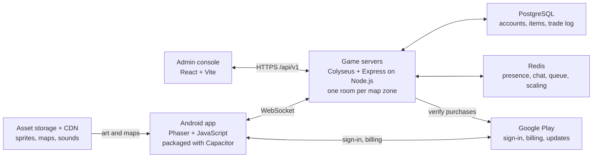

# Heartshard — Open-World Pixel MMORPG Full Game Plan

Oct 27, 2026 · Laud Zion Cascalla

## Vision and pitch

Build an original 2D pixel-art MMORPG for Android. It takes Inotia's dark-fantasy story and party feel and puts them in a Ragnarok-style shared world, where players trade, run vending stalls and form guilds. You earn from cosmetics, a season pass and convenience items. Players never cash out real money.

- **Title:** *Heartshard*, named after the Mark the player carries (short, easy to search on the Play Store, and no game found under that name; run a formal trademark search before launch). Store listing: *Heartshard: Pixel MMORPG*. Velmora stays the name of the world, not the title, because several small indie games already use it.
- **Genre:** 2D top-down action MMORPG, pixel art, landscape mode
- **Audience:** players nostalgic for Inotia, Zenonia and Ragnarok Online, mostly on mid-range Android phones
- **Hook:** you can play solo thanks to hired mercenaries, but the best loot and the most fun come from parties, trading and guilds
- **Signature feature:** every piece of gear shows on your character. Equip a new helmet, armor or weapon and your sprite changes, so other players can see what you earned.
- **Theme:** what do you do with power that isn't yours? Every faction, villain and quest answers that question differently.

**IP rule:** take nothing from Inotia (names, characters, maps, art, music, story) and nothing from Ragnarok (names, sprites, job names, card art). Mechanics such as job advancement, vending and socketed gear are free to use. Copied assets or names are not.

## Mobile or web: both, from one codebase

Build the game with web technology and package it as an Android app. That gets you a Play Store app now and a browser version later from the same code, with no second client to maintain.

|                    | Android app (Play Store)                                                             | Web game (browser)                                   |
| ------------------ | ------------------------------------------------------------------------------------ | ---------------------------------------------------- |
| Discovery          | Play Store search, features, ratings                                                 | You have to bring all the traffic yourself           |
| Payments           | Google Play Billing; trusted and impulse-friendly, but Google takes a service fee    | Stripe or PayPal; lower fees, but fewer impulse buys |
| Updates            | Client builds go through store review; server-side content updates go live instantly | Instant                                              |
| Performance        | Best                                                                                 | Good enough for 2D pixel art                         |
| Getting started    | Players must download it                                                             | One link and they're playing                         |
| Push notifications | Yes                                                                                  | Limited                                              |

**Recommendation:** ship an Android app built with web tech (Phaser, wrapped with Capacitor). The Play Store gives you discovery and trusted payments, and those matter most for earnings. The web build then becomes free marketing: a playable link you can share on TikTok and in Facebook gaming groups. iOS can come later through the same Capacitor wrapper.

## World and story

### The world

Three hundred years ago the **Sunspire**, a tower of living light at the heart of Velmora, held the continent together. Its keepers drew power from its core and shared it with every town. When the Sunspire fell, the core shattered into thousands of glowing **Shards** that rained across the land. Where a Shard lands, it grants power to whatever touches it, and slowly twists it.

Velmora is now a broken continent of separate regions, each shaped by the Shards that fell there. Monsters that swallow Shards grow stronger and stranger. When one dies, the Shard's imprint sometimes survives as a **sigil**, which smiths can socket into gear (the game's sigil system).

### Shards and Heartshards

The whole story turns on one difference:

|               | Shards                                                             | Heartshards                                                      |
| ------------- | ------------------------------------------------------------------ | ---------------------------------------------------------------- |
| How many      | Thousands, everywhere                                              | Exactly **seven**                                                |
| What they are | Splinters of the Sunspire's core                                   | The seven pieces of the core that survived whole                 |
| Power         | Strengthen whoever holds them, and slowly twist them               | Far stronger than any Shard; each one can reshape a whole region |
| In the game   | Common: Shard dust for refining, sigils from monsters, quest items | Story only: never dropped, sold or traded                        |

Each Heartshard sank into a different region and changed it: the **Glass Heartshard** turned a grassland into the Ashen Dunes, the **Thorn Heartshard** woke Whisperwood, the **Rime Heartshard** froze the Frostveil Peaks. The other three are lost, and nobody knows what they did to the places where they fell.

The seventh is the **Mark** in the player's palm, and it is the most important of all: it is the only Heartshard that can absorb the others. Whoever gathers all seven, with the Mark at the center, can rebuild the Sunspire and decide what Velmora becomes. That is the race at the heart of the story.

### The factions

Two forces fight over the Shards. Both believe they are saving Velmora.

| Faction               | Leader                                      | Belief                                                                     | What they want from the player                                                              |
| --------------------- | ------------------------------------------- | -------------------------------------------------------------------------- | ------------------------------------------------------------------------------------------- |
| **The Dawn Covenant** | High Warden Aurelle Sunmark                 | The Shards caused the fall. Seal them away before they ruin what is left.  | A living seal: the Mark can hold Shards safely, so the player could lock them away for good |
| **The Umbral Court**  | Regent Morvaine, who never removes her veil | The Shards are the only power left. Use them, or let the strong take them. | A living weapon: the Mark can wield Shards without being twisted                            |

Neither faction is evil. The story shows both are half right: sealing alone leaves Velmora powerless, and wielding alone corrupts.

### The player: the Wayfarer

The player is a **Wayfarer**, an outsider with no home region, who wakes in a wrecked caravan with a Shard fused into their palm: **the Mark**. The Mark is the seventh **Heartshard**, the only one that can absorb the others without twisting its bearer. Every Heartshard the player claims makes the Mark stronger. That is why both factions court the player, and why the villain hunts them.

### The villain

**Ezrim, the Last Keeper** was the youngest keeper of the Sunspire. He tried to make himself its heart, and his ritual is what brought the tower down. Everyone believes he died in the fall. He survived inside a shell of ice, and his masked followers, **the Hollowed**, hunt the Heartshards so he can rebuild the Sunspire with himself at its core. He can take the regional Heartshards by force, but only the Mark can join them together, so in the end he needs the player.

### Main story at launch

The full plot (beat by beat for every chapter, character arcs, both faction paths, side stories and the season outlines) is in [Heartshard — Story Plot](Heartshard%20—%20Story%20Plot.md). The summary below must stay consistent with it.

The campaign is chapter by chapter (the Inotia feel). Each chapter is the hunt for one Heartshard: it unlocks a zone, and ends in a boss dungeon where that Heartshard is won or lost. Level ranges line up with the systems they introduce.

| Chapter                                 | Levels | Zone                         | What happens                                                                                                                                                                                                                                                                                                                                                                                                                                                                                                                   | Dungeon and boss                                                           | Systems it introduces                                     |
| --------------------------------------- | ------ | ---------------------------- | ------------------------------------------------------------------------------------------------------------------------------------------------------------------------------------------------------------------------------------------------------------------------------------------------------------------------------------------------------------------------------------------------------------------------------------------------------------------------------------------------------------------------------ | -------------------------------------------------------------------------- | --------------------------------------------------------- |
| **Prologue: The Marked**                | 1–10   | Harrowgate and its outskirts | The Wayfarer wakes with the Mark and is taken in by Ilsa Varn of the Wayfarers' Hall. Shard-swollen beasts attack the gate, and the Mark absorbs their Shards in front of the whole town. Both factions realize a Heartshard has woken up.                                                                                                                                                                                                                                                                                     | Field boss: the Gatebreaker, a Shard-swollen boar                          | Combat, first mercenary, vending stalls, chat             |
| **Chapter 1: Glass and Ash**            | 10–25  | Ashen Dunes                  | Teodric the Lampwright tells the Wayfarer the legend of the seven Heartshards. The Ash Clans report a hive whose queen has swallowed the Glass Heartshard. Ser Calden of the Dawn and Sable of the Umbral both follow the Wayfarer, each trying to earn their trust. The Hollowed reach the hive too. The Wayfarer wins the race, and the Mark absorbs the Glass Heartshard: the first of the seven.                                                                                                                           | Sunken Reliquary: Queen Saqqra of the Glass Hive                           | Parties, refining, sigils, travel mounts at 20            |
| **Chapter 2: The Rootbound Choice**     | 25–40  | Whisperwood                  | The Thornmother has guarded the Thorn Heartshard for three hundred years, and the Hollowed have poisoned her to take it. The Thorn Heartshard is too wild for the Mark to absorb yet, so at level 30 the Wayfarer must choose who keeps it once it is saved: the Dawn wants to seal it in their vault, the Umbral wants to bind it into a weapon. Both paths end the same way: the Hollowed steal it from whichever side took it, proving neither plan can protect a Heartshard. Before she dies, the Thornmother names Ezrim. | Rootdeep Hollow: the Thornmother, a forest spirit poisoned by the Hollowed | Faction choice at 30, guilds, pets, job advancement at 40 |
| **Chapter 3: The Rime Below the Spire** | 40–60  | Frostveil Peaks              | The trail leads to the frozen peaks, where Ezrim has gathered the Thorn and Rime Heartshards under the ice. The Frostveil riders teach the Wayfarer to fight from a mount. In the vault, the Wayfarer learns the truth about the fall and faces Varkhal, a war construct powered by the Rime Heartshard.                                                                                                                                                                                                                       | Hoarfrost Vault: Varkhal the Rimebound, then a first meeting with Ezrim    | Battle mounts at 45, open-world bosses                    |

**Ending of the launch story:** Ezrim tears the Glass Heartshard out of the Mark and escapes into **the Scar**, the crater where the Sunspire stood, holding three of the seven. Dawn and Umbral agree to an uneasy truce to follow him.

**The seasons:** the launch story leaves a clear count. Ezrim holds three Heartshards (Glass, Thorn, Rime), the player holds the Mark, and three are still lost. Each season adds a new region and the hunt for one lost Heartshard, racing the Hollowed to it. The final season takes the Wayfarer into the Scar to face Ezrim for all seven.

**Endgame at level 60:** open-world bosses, guild content, crafting and trading, and later the Scar, faction PvP zones and guild-vs-guild battles.

### Key characters

| Character                       | Where                   | Role in the story                                                                                                            | Role in the game                                 |
| ------------------------------- | ----------------------- | ---------------------------------------------------------------------------------------------------------------------------- | ------------------------------------------------ |
| **Ilsa Varn**                   | Harrowgate              | Gruff former mercenary who runs the Wayfarers' Hall. Takes the Wayfarer in and treats them like a recruit, not a chosen one. | Tutorial guide and mercenary broker              |
| **Pell**                        | Harrowgate              | A street kid who sells anything to anyone and knows every rumor in town. Comic relief with a soft heart.                     | Teaches trading and vending                      |
| **Teodric the Lampwright**      | Harrowgate              | An old acolyte who survived the fall. Knows what Heartshards are and feels guilty about what he didn't stop.                 | Lore keeper; runs refining with Shard dust       |
| **Ser Calden Rook**             | Dawn Covenant           | An honest, rigid knight assigned to guard the Wayfarer. Slowly learns that rules alone don't fix a broken world.             | Dawn quest giver; Vanguard and Cleric mentor     |
| **Sable**                       | Umbral Court            | A charming, practical agent who recruits the Wayfarer with jokes and honesty about what the Court wants.                     | Umbral quest giver; Shadowblade and Hexer mentor |
| **High Warden Aurelle Sunmark** | Dawn Covenant           | Leads the Covenant. Lost her family in the fall and will seal every Shard, whatever it costs.                                | Dawn faction leader                              |
| **Regent Morvaine**             | Umbral Court            | Rules the Court from behind a veil. Wears it because her face was changed by a Shard she refused to give up.                 | Umbral faction leader                            |
| **Ezrim, the Last Keeper**      | Unknown, then Frostveil | Caused the fall and believes he can undo it if he becomes the new core. Calm, polite and certain he is right.                | Main villain                                     |
| **The Hollowed**                | Everywhere              | Ezrim's masked followers, people twisted by Shards who believe he will cure them.                                            | Common enemies and elite mobs                    |

### Classes

Every class comes from a part of Velmora. Class choice never locks the faction; any class can join Dawn or Umbral.

| Class           | Role                              | Origin                                                                                   | Job advancement at level 40                                                 |
| --------------- | --------------------------------- | ---------------------------------------------------------------------------------------- | --------------------------------------------------------------------------- |
| **Vanguard**    | Tank: shields, taunts             | Harrowgate's wall guard, who held the gate the night the Sunspire fell                   | Bulwark (pure defense) or Warlord (shouts that buff the party)              |
| **Shadowblade** | Burst melee, stealth              | Couriers and spies who move between the regions                                          | Nightstalker (stealth assassin) or Duelist (one-on-one burst)               |
| **Arcanist**    | Ranged magic, area damage         | Scholars of the fallen Sunspire Academy, still studying the Shards                       | Pyromancer (fire, damage over time zones) or Stormcaller (lightning chains) |
| **Warden**      | Bow plus light support            | Rangers of Whisperwood who live alongside its beasts                                     | Ranger (long-range damage) or Beastmaster (fights with an animal companion) |
| **Hexer**       | Curses, damage over time, debuffs | The Ash Clans of the dunes, who learned to bend a Shard's twisting power against enemies | Plaguecaller (spreading curses) or Soulbinder (drains life to fuel spells)  |
| **Cleric**      | Main healer, buffs, shields       | Chapels that once tended the Sunspire's light                                            | Sanctifier (big heals and shields) or Oracle (buffs and foresight)          |

All 6 classes are available at launch, giving every party a full spread of tanks, damage dealers and healers. Later updates add third-job advancements instead of new base classes, which brings veteran players back without splitting the playerbase.

**Mercenaries:** players hire NPC companions at the Wayfarers' Hall, one at a time at launch. Each mercenary is a named character with a class and a short backstory. Mercenaries let solo players progress and keep the Inotia feel, but a real player party always beats them at bosses.

## Core game systems

Launch with the systems that make players stay and trade, and leave everything else for updates.

### Two layers: a private campaign and a shared open world (Albion-style)

|              | Story campaign                               | Open world                                        |
| ------------ | -------------------------------------------- | ------------------------------------------------- |
| Who is there | Instanced: one player or their party         | Everyone on the server                            |
| Purpose      | Level up, learn your class, follow the story | Meet, trade, craft, fight bosses, guild wars, PvP |
| Rewards      | EXP and account-bound gear (can't be traded) | Tradeable loot, crafting materials, rare sigils   |
| Server cost  | Low (small rooms, spun up on demand)         | Higher (persistent zones, many players)           |

The rule that protects the economy: the campaign makes players strong, and the open world makes them rich. Tradeable items come mainly from open-world drops and player crafting, as in Albion, so the market always has demand.

### At launch (v1)

- **Combat:** real-time, with a virtual joystick, auto-attack on tap and a 4-slot skill bar
- **Progression:** levels 1–60, stat points and a skill tree per class, faction choice at 30, job advancement at 40
- **Characters:** 3 character slots per account, the same for every player. Extra slots are never sold, which keeps alt accounts and bot farms harder to run
- **Parties:** up to 4 players, with shared EXP and loot rules
- **Mercenaries:** one hired companion per player, upgradable
- **Loot and gear:**
  - rarity tiers
  - refining from +1 to +10 with Shard dust, with a chance to fail
  - monster sigils socketed into gear (your own take on Ragnarok's cards)
- **Trading:** a face-to-face trade window with a two-step confirm, plus player vending stalls in Harrowgate
- **Chat:** zone, party, guild and whisper channels, with a profanity filter and a report button
- **Guilds:** create a guild, set ranks, guild chat, shared storage

### Visible gear (at launch)

Like Inotia, every equipped item appears on the character. This is a core feature, not a cosmetic extra: it is what makes loot exciting and what makes a well-geared player stand out in Harrowgate.

- **Visible slots:** hair, helmet, body armor, gloves, boots, cape, main-hand weapon, off-hand (shield, book or quiver). Rings and necklaces stay hidden.
- **How it works:** each character is a stack of sprite layers (body, then each gear slot) that play the same animation frames together. In crowded towns, the layers are merged into one texture when gear changes, so a busy market still runs smoothly on mid-range phones.
- **Keeping art affordable:**
  - 4 directions (left is a mirror of right, so only 3 are drawn)
  - 6 animations: idle, walk, attack, cast, hit, death
  - Gear comes in families (for example, one leather armor shape), and rarity tiers are palette swaps of the same shape, recolored in the game rather than drawn again
  - Every gear sheet uses the same frame layout as the body sheet, from one template
- **Refining shows too:** +7 and above adds a subtle glow to the weapon, so refined gear is visible at a glance.
- **Cosmetics:** shop outfits replace how gear looks, never its stats. Players can hide their helmet or show an outfit over their armor.
- **Data:** each item in `shared/data/items.js` has an `appearance` ID that points to its sprite sheet and palette in `shared/data/appearances.js`.

### Effects and animation: Inotia's soul, modern polish

Inotia is the inspiration for the story and the party feel, not the visual ceiling. The game keeps crisp pixel art but adds the lighting, effects and game feel players expect today.

**Combat feel**
- **Hit stop:** the game freezes for a few frames when a big hit lands, so attacks feel heavy
- **Smear frames and anticipation:** attack animations wind up and swing through, instead of snapping between poses
- **Knockback and hit flash:** enemies flash white and slide back when struck
- **Damage numbers:** they pop and scale up on crits, with different colors for crits, heals and damage over time
- **Screen shake:** subtle and short, only for heavy hits and boss attacks
- **Haptics:** a short vibration on crits, level ups and rare drops (Capacitor Haptics)

**Lighting and atmosphere**
- **Dynamic lights:** torches, spells, glowing Shards and refined weapons light up the area around them (Phaser's Light2D with normal maps)
- **Day and night cycle** in the open world, with a colored mood for each zone: warm haze in Ashen Dunes, green filtered light in Whisperwood, cold blue in Frostveil
- **Post effects:** bloom on spells and Shards, a soft vignette, glow on +7 and higher gear (Phaser's built-in FX)
- **Weather and ambient particles:** blowing sand, falling leaves, snow, drifting embers
- **Living maps:** animated water and grass, parallax background layers, soft shadows under every character

**Skills and bosses**
- Each class has its own effect color and style, so players can read a fight at a glance: Arcanist fire and lightning, Cleric gold light, Hexer violet smoke, and so on. The job advancements at 40 get upgraded versions.
- Skill effects are separate sprite sheets and particles drawn on top of the character, not extra character frames, so the visible gear art stays affordable.
- Bosses get an intro: the camera zooms in, a title card appears, the music changes, and the attack telegraphs on the ground are clear.

**Interface**
- Panels slide and fade in, buttons respond on press, and rare drops get a short reveal with a beam of light in their rarity color.

**Performance and comfort**
- **Graphics presets:** low, medium and high, chosen automatically from the phone's speed and changeable in settings. Low turns off lights, bloom and weather.
- **Target:** 60 fps on mid-range phones, never below 30. Effects come from texture atlases and pooled particles, never created fresh each frame.
- **Crowded towns:** effects from your own party show in full, while other players' effects are reduced.
- **Comfort settings:** turn off screen shake and flashes, and respect the phone's reduced motion setting.
- **Configs:** every value (hit stop length, shake strength, particle limits, preset settings) lives in `game/src/configs/graphics.js`.

### Pets, mounts and battle mounts (at launch)

|                 | Pets                                                         | Travel mounts                                               | Battle mounts                                                 |
| --------------- | ------------------------------------------------------------ | ----------------------------------------------------------- | ------------------------------------------------------------- |
| What it does    | Follows you, auto-picks up loot, gives a small passive bonus | Faster movement outside combat                              | Ridden in combat, with its own skills (charge, trample, roar) |
| How you get one | Tame wild monsters with a taming item; also hatch eggs       | Campaign quest at level 20, crafting, rare open-world drops | Open-world bosses, guild content and crafting, from level 45  |
| Progression     | Feed it to raise loyalty; it levels up and unlocks bonuses   | Different speeds by tier                                    | Levels up, with gear slots (saddle, armor)                    |
| Tradeable?      | Yes, as eggs or tamed pets: a big part of the market         | Crafted mounts yes, quest mounts no                         | Yes, which makes them top-tier trade goods                    |
| In the shop     | Skins only                                                   | Skins only                                                  | Skins only                                                    |

- Battle mount stats stay below gear in power, and heavy hits knock the rider off. That keeps PvP about skill, not whoever owns the best mount.
- Pets support you and mercenaries fight for you, so a solo player can run with both.
- The server's movement-speed checks must account for each mount's speed, or legitimate riders will be flagged as speed hackers.

### After launch

- The Scar: the next story zone and Ezrim's stronghold
- Auction house (search listings and buy from anyone, even when the seller is offline)
- Guild halls and weekly guild-vs-guild battles
- Opt-in faction PvP zones
- World bosses on a timer
- Crafting professions and player housing
- Seasonal events

Traded items only hold value if they stay scarce. So every item gets a unique ID, and every trade is logged.

### Admin console

A separate web app for you and future staff, built at the same time as the alpha:

- Server mode switch: live, beta, maintenance, coming soon (with a message and an expected return time)
- Players: search, view characters and inventory, mute, ban, restore items
- Economy dashboard: gold in circulation, gold earned per player per hour, top trades
- Shop: items, prices, season pass tracks, events
- Reports and support: chat reports, bug reports, ban appeals
- Guided tours for each page, so a non-technical moderator can use it on day one

## Tech stack

Use **plain JavaScript** end to end, on both the client and the server, following the project rules. One language lets you share code (item stats, damage formulas, message formats) between client and server through a `shared/` package. Use JSDoc comments where types help.

| Layer                 | Choice                                               | Why                                                                                                                                                        |
| --------------------- | ---------------------------------------------------- | ---------------------------------------------------------------------------------------------------------------------------------------------------------- |
| Game client           | Phaser 3 + JavaScript, built with Vite               | Mature 2D web engine, good for pixel art, works in plain JavaScript                                                                                        |
| Android packaging     | Capacitor                                            | Wraps the web build as a Play Store app; iOS later with the same tool                                                                                      |
| Maps                  | Tiled editor                                         | Standard tilemap tool that loads straight into Phaser                                                                                                      |
| Game server           | Colyseus (Node.js)                                   | Rooms per zone and per campaign instance, state synced to players. In plain JavaScript, state schemas use `defineTypes()` instead of TypeScript decorators |
| HTTP API              | Express in the same Node app                         | Accounts, shop, purchase checks, admin console; versioned under `/api/v1`                                                                                  |
| Admin console         | React + Vite, TanStack Query                         | Follows the React + Node rules (optimistic updates, caching, guided tours)                                                                                 |
| Database              | PostgreSQL                                           | Accounts, characters, inventories, trade log; transactions keep trades safe                                                                                |
| Cache and messaging   | Redis                                                | Who is online, chat, leaderboards, messages between server instances                                                                                       |
| Job queue             | BullMQ (on the same Redis)                           | Purchase checks, retries, emails, economy snapshots, ban waves                                                                                             |
| Validation            | zod                                                  | The same schemas check client messages, API requests and admin forms                                                                                       |
| Login                 | Google Play Games sign-in or Firebase Auth           | Free, one-tap login on Android                                                                                                                             |
| Payments              | Google Play Billing (Stripe later for the web build) | Receipts are verified on your server before items are granted                                                                                              |
| Analytics and crashes | Firebase Analytics + Crashlytics                     | Free; shows where players quit                                                                                                                             |
| Tests                 | Vitest                                               | Fast tests for formulas, services and trade rules                                                                                                          |
| Art                   | Aseprite + itch.io asset packs                       | Prototype with packs, replace with original art later                                                                                                      |

### System architecture

Players talk only to the game servers, which own all the data.



The server is authoritative: the app only sends inputs (move, attack, use skill), and the server decides damage, drops and trades. Purchases are checked with Google Play from the server side.

**Alternatives:**
- **3D instead of pixel art:** keep the same server, database and Capacitor wrapper, and swap Phaser for Babylon.js or Three.js (both JavaScript), with low-poly models made in Blender. 3D is heavier on mid-range phones, so test on real devices early.
- **A full game engine:** Godot 4 for the client plus Nakama for the backend is the other solid route. You'd gain a visual editor but lose JavaScript and the shared code.

## Folder structure

One repository, one modular monolith, plain JavaScript, kebab-case file names. Each feature owns its rules, data access and UI. Game balance numbers live in `shared/data/`, never hardcoded in code.

```
/
├── game/                                   # Phaser client (web build and Android app)
│   ├── index.html
│   ├── vite.config.js
│   ├── capacitor.config.js
│   ├── android/                            # Generated Android project (Capacitor)
│   ├── public/assets/                      # Sprites, tilesets, exported maps, audio (served by CDN in production)
│   └── src/
│       ├── main.js                         # Creates the Phaser game
│       ├── scenes/                         # Thin scenes: boot, loading, title, world, ui-overlay
│       ├── features/                       # One folder per feature (client side)
│       │   └── <feature>/                  # appearance, combat, inventory, trade, vending, chat, party, guild, pets, mounts, quests, shop
│       │       ├── systems/                # Rendering and input for this feature
│       │       ├── ui/                     # Panels and windows for this feature
│       │       └── net.js                  # Messages this feature sends and receives
│       ├── components/ui/                  # Shared widgets: button, panel, list, tooltip, joystick, skill-bar, pager
│       ├── configs/                        # public.js (only file reading import.meta.env), game.js, graphics.js, controls.js, api.js, audio.js
│       └── lib/
│           ├── net/room-client.js          # Colyseus connection, reconnects
│           ├── api/                        # http.js and client.js (every HTTP call, grouped by feature)
│           ├── billing/strategies/         # google-play.js, stripe-web.js, plus factory.js
│           ├── fx/                         # Hit stop, shake, damage numbers, lighting and particle pools
│           └── analytics.js, storage.js, toast.js
│
├── admin/                                  # React + Vite admin console (React + Node rules)
│   └── src/
│       ├── pages/                          # dashboard, players, economy, shop, reports, server-mode
│       ├── features/<feature>/             # components/ and hooks/ with optimistic updates
│       ├── components/                     # ui/, layout/, tour/ (guided tours from configs/tours.js)
│       ├── configs/                        # api.js, query.js, navigation.js, tours.js
│       └── lib/                            # api/, query-client.js, toast.js
│
├── server/                                 # Node: Colyseus game server and Express API in one app
│   ├── src/
│   │   ├── index.js                        # Starts HTTP and game servers
│   │   ├── app.js                          # Express: security headers, CORS, routes under /api/v1, error handler
│   │   ├── rooms/                          # Thin Colyseus rooms: zone-room.js, campaign-room.js, trade-room.js
│   │   ├── modules/                        # One folder per feature (server side)
│   │   │   └── <module>/                   # accounts, characters, inventory, items, loot, combat, quests, trade, vending,
│   │   │       │                           # party, guilds, chat, pets, mounts, shop, billing, economy, moderation, admin
│   │   │       ├── routes.js               # HTTP routes (when the module has any)
│   │   │       ├── controller.js           # Reads the request, calls one service function
│   │   │       ├── handlers.js             # Room message handlers, wrapped with auth, validation and rate limits
│   │   │       ├── service.js              # Game rules as fn(ctx, input)
│   │   │       ├── repository.js           # Database reads and writes only
│   │   │       ├── jobs.js                 # Background jobs and retry settings
│   │   │       ├── events.js               # Event names this module emits
│   │   │       └── strategies/             # Swappable providers (billing: google-play, stripe)
│   │   ├── middleware/                     # auth, validate, rate-limit, server-mode, error-handler
│   │   ├── configs/                        # env.js (only file reading process.env), app.js, server-mode.js, rooms.js, queue.js
│   │   ├── lib/                            # errors, context, events (event bus), queue/, cache, logger, circuit-breaker
│   │   ├── db/                             # client.js (pool and transactions), migrations/, seeds/
│   │   └── jobs/                           # Scheduled jobs: economy snapshots, ban waves, cleanup
│   └── tests/                              # Service, trade and anti-cheat tests, one folder per module
│
├── shared/                                 # Plain JavaScript used by game, admin and server
│   ├── data/                               # classes, skills, items, appearances, monsters, zones, drop-tables, sigils, pets, mounts, quests/
│   ├── formulas/                           # damage.js, exp.js, refine.js, drop-roll.js
│   ├── schemas/                            # zod schemas for room messages and API requests
│   └── constants/                          # Message types, rarities, protocol version
│
├── maps/                                   # Tiled source files; exported into game/public/assets/maps
├── scripts/                                # migrate.mjs, seed.mjs, reset.mjs, play-setup.mjs, economy-report.mjs
├── docs/                                   # This plan, design doc, decisions
├── docker-compose.yml                      # Local Postgres and Redis
└── package.json                            # npm workspaces: game, admin, server, shared
```

**Data flow:** the player taps a button → the feature's `net.js` sends a message → the room passes it to the module's `handlers.js` → validation and rate limit → `service.js` applies the game rules → `repository.js` saves inside a transaction → the room broadcasts the new state.

**npm commands:** `npm run dev` (everything locally), `npm run migrate`, `npm run db:seed` (local test data plus the default admin test account), `npm run db:reset` (local only), `npm run android` (build and open in Android Studio), `npm run test`.

## Engineering rules applied to the game

The project rules (modular monolith, plain JavaScript, central configs, design patterns, ACID, idempotency, caching, queueing) map onto the game like this.

### Design patterns

| Pattern             | Where it is used in the game                                                                                                                                                                            |
| ------------------- | ------------------------------------------------------------------------------------------------------------------------------------------------------------------------------------------------------- |
| **Repository**      | Every database read and write goes through a module's `repository.js`. Rooms and services never write queries.                                                                                          |
| **Strategy**        | Billing (Google Play Billing on Android, Stripe on the web build) and login providers, each behind the same methods.                                                                                    |
| **Factory**         | Picks the billing and login provider by platform; builds monsters and NPCs from `shared/data/`.                                                                                                         |
| **Observer**        | Modules emit events (`monster.killed`, `item.dropped`, `trade.completed`, `level.up`) on the event bus. Quests, achievements, the economy log, notifications and analytics each subscribe on their own. |
| **Builder**         | Item creation: base item, then rarity, refine level, sockets and sigils, then `build()`. Also drop tables and admin reports.                                                                            |
| **Adapter**         | Google Play, Firebase, analytics, push notifications and asset storage, each wrapped so the rest of the code never imports their SDKs.                                                                  |
| **Decorator**       | Room message handlers are wrapped with auth, zod validation, rate limits and logging, so game rules stay clean.                                                                                         |
| **Singleton**       | One database pool, one Redis client and one queue per server process.                                                                                                                                   |
| **CQRS (light)**    | Game actions write through transactions; the economy dashboard and leaderboards read from summary tables and Redis.                                                                                     |
| **Circuit breaker** | Calls to Google Play's purchase check: if Google is down, purchases wait in the queue and are granted once checked, instead of every player getting an error.                                           |

### Data safety

- **ACID:** trades, vending purchases, refining (materials used and result saved together), mail and shop purchases each run as one database transaction. Gold and item counts change in a single statement or under a row lock, never read, changed in code and written back.
- **Idempotency:**
  - Every Google Play purchase token is stored under a `unique` constraint, so a purchase is granted only once even if the app sends it twice.
  - Google's purchase notifications are deduplicated by their message ID.
  - Each trade, loot pickup and quest reward has its own ID and can only complete once.
- **Queueing:** purchase checks, Google notifications, emails, economy snapshots and ban waves run as background jobs with retries. Jobs are written to an outbox table in the same transaction as the data that caused them.
- **Caching:** Redis holds presence, leaderboards and the shop catalog. Static game data is cached on the device by version and refreshed when a new version is published.
- **Throttling:** the client sends movement at a fixed tick rate from config, not on every frame. The server rate limits every action and chat message per player.
- **Optimistic updates:** only for safe UI actions (moving items between bag slots, sending chat). Never for trades, purchases, gold or loot: those always wait for the server.

### Versions and modes

- **API versioning:** HTTP routes live under `/api/v1`. Room messages carry a protocol version from `shared/constants/`. When the server's version moves ahead, older app builds are asked to update instead of breaking.
- **Server modes:** live, beta, maintenance and coming soon, set from the admin console and checked at sign-in, with a message and an expected return time.
- **Loading after sign-in:** a loading screen with a progress bar and a checklist of real steps ("Signing you in", "Loading your character", "Downloading Harrowgate", "Joining the world"). Each step checks off when it actually finishes.
- **Configs:** every setting lives in `configs/` or `shared/data/`: tick rates, rate limits, drop rates, prices and refine odds. Only `configs/env.js` reads environment variables.

## Hosting and infrastructure

Start on one cheap server and move to containers once you have real players. Host near your players: Singapore for Southeast Asia, Frankfurt for Europe and the Middle East. Once ping goes above roughly 150 ms, real-time combat starts to feel laggy.

| Stage                                   | Setup                                                                                                   | Approx. monthly cost          |
| --------------------------------------- | ------------------------------------------------------------------------------------------------------- | ----------------------------- |
| Development                             | Docker Compose on your machine: game server, Postgres, Redis                                            | $0                            |
| Closed alpha (up to ~100 players)       | 1 VPS (4 vCPU, 8 GB RAM) running everything in Docker Compose; daily database backups to object storage | $20–50                        |
| Open beta (up to ~1,000 online at once) | 2–3 game server VMs behind a load balancer, managed Postgres, managed Redis, CDN for assets             | $150–400                      |
| Launch and growth                       | Game servers autoscaled on Kubernetes, database read replicas, CDN                                      | $500+ and rising with players |

Providers: Hetzner is the cheapest for VPS. DigitalOcean is simple and has managed databases. AWS or GCP fit if you want everything managed. All costs above are rough estimates.

### Ops checklist

- CI/CD with GitHub Actions: run tests, build the server Docker image and the Android app bundle (AAB) on every push
- A separate staging environment, never testing on production
- Database changes only through `npm run migrate`, which asks for confirmation before touching a hosted database
- Monitoring with Prometheus + Grafana, plus uptime alerts to your phone
- Daily backups, with a restore you've actually tested
- Zero-downtime deploys: stop new players joining old rooms, let them empty, then restart

## Monetization

Earn from cosmetics, a season pass and convenience, and never sell raw power. Paid power ruins the player economy that trading depends on.

| Product                 | What it is                                                                    | Approx. price              |
| ----------------------- | ----------------------------------------------------------------------------- | -------------------------- |
| Cosmetics               | Outfits, weapon skins, pet and mount skins (visual only)                      | $1.99–9.99                 |
| Season pass             | Free and premium reward tracks, about 8 weeks each, tied to each story season | $4.99                      |
| Premium membership      | Extra storage, an extra vending slot, a small EXP bonus                       | $4.99 / month              |
| Convenience             | Name change, bigger bags, extra storage tabs                                  | $0.99–4.99                 |
| Gem bundles             | Premium currency used in the shop                                             | $0.99–49.99                |
| Rewarded ads (optional) | Watch an ad for a short buff                                                  | Ad revenue from non-payers |

- In-app purchases on Android must go through Google Play Billing. Google takes a service fee, currently 15% on the first $1M of earnings each year for most developers; confirm the current rate in Play Console.
- Avoid paid random loot boxes at launch. Google requires you to publish the odds, and many countries are tightening the rules on them.
- Fees charged in gold (the in-game currency), such as vending tax or auction fees, are not revenue. They exist to remove gold from the game and keep prices stable.
- Typically only 2–5% of players ever pay, so the free experience has to be good on its own.

## Economy safety, anti-cheat and legal

A single item-duplication bug or bot farm can wreck the economy in a weekend, so build these protections in from day one.

### Economy

- The server decides everything: the app never reports damage, gold or loot
- Each trade runs as one database transaction: lock both sides' items in escrow, then swap, or roll back completely
- Every item has a unique ID, and an append-only log records every trade, drop and purchase
- Gold sinks keep prices stable: repair costs, refining fees, vending tax, teleport fees
- An economy dashboard tracks total gold in circulation and gold earned per player per hour

### Anti-cheat and bots

- Rate limits on actions and chat; the server checks movement speed and position
- Flag non-human play, such as round-the-clock farming or identical paths
- Google Play Integrity API to block modified apps
- Ban in waves, not instantly, so cheaters can't tell what triggered detection

### Legal

- Terms of service that ban real-money trading of accounts and items
- A privacy policy, plus the Data safety form in Play Console
- An age rating through the IARC questionnaire in Play Console
- Original names and art only, plus a trademark search on the final title
- Decide whether to publish as an individual or a company, and check Google Play's merchant requirements for the UAE; a local business advisor can confirm the licensing side

## Roadmap

Aim for a first playable build by month 3 and launch around month 13, assuming you work with one part-time artist. Expect it to take longer: each gate is a checkpoint where you fix problems before adding more content.

**First playable by month 3, launch around month 13** (6 phases, 4 gates)

| Phase          | When            | What                                                                                                                                                                                                                                   |
| -------------- | --------------- | -------------------------------------------------------------------------------------------------------------------------------------------------------------------------------------------------------------------------------------- |
| Plan           | Month 1         | Design doc, story bible, art style, small tech test. Repo set up with the folder structure above, CI, Docker dev environment and `npm run` scripts                                                                                     |
| Prototype      | Months 2 to 3   | One map, movement, auto-attack, two skills. Two players see each other and fight together online. Layered character sprite with 2 swappable gear pieces. Hit stop, hit flash, damage numbers and one lit area to prove the combat feel |
| **Gate**       |                 | **Combat feels fun with two players**                                                                                                                                                                                                  |
| Vertical slice | Months 4 to 6   | Vanguard complete, Harrowgate, Ashen Dunes, prologue and chapter 1. Inventory, loot, parties, trade window, saving to Postgres                                                                                                         |
| **Gate**       |                 | **10 testers finish the slice and ask for more**                                                                                                                                                                                       |
| Closed alpha   | Months 7 to 9   | 6 classes, Ashen Dunes, Whisperwood and Frostveil Peaks, the Sunken Reliquary dungeon, pets, mounts, guilds, vending, admin console. 50 to 100 invited testers via Play Console closed testing                                         |
| **Gate**       |                 | **No item duplication found, testers return in week 2**                                                                                                                                                                                |
| Open beta      | Months 10 to 12 | Chapters 2 and 3 with their dungeons, faction choice, job advancement, battle mounts, shop and season pass. Open testing on Play Store. Load tests, anti-bot tools, economy dashboards                                                 |
| **Gate**       |                 | **Servers hold the target player count in load tests**                                                                                                                                                                                 |
| Launch         | Month 13 onward | Soft launch in one region, then a wider release. Live content: events monthly, the Scar as the first season, then a new zone or class advancement each season                                                                          |

Don't move past a gate until it's met. Fun combat and a safe economy matter more than the number of zones.

## Team, budget and next steps

The smallest team that can ship this is you plus one part-time freelance pixel artist. You'd handle the server, backend and client code. Music and sound effects can come from licensed packs at first.

| Item                                                | Approx. cost, first 12 months                                                                                                            |
| --------------------------------------------------- | ---------------------------------------------------------------------------------------------------------------------------------------- |
| Pixel art (freelancer)                              | $5,000–14,000, or $200–500 in asset packs to start (higher than a typical 2D game because every gear piece needs its own animated sheet) |
| Effects (spell and particle packs, normal map tool) | $100–300                                                                                                                                 |
| Music and sound effects                             | $100–1,000 (licensed packs)                                                                                                              |
| Hosting through open beta                           | $500–1,500                                                                                                                               |
| Google Play developer account                       | $25, one time                                                                                                                            |
| Tools, domain, misc.                                | About $100                                                                                                                               |
| **Total**                                           | **Roughly $6,000–17,500**                                                                                                                |

### This week

- [ ] Run a formal trademark search on *Heartshard* and reserve the domain and social handles
- [ ] Write a 2-page design doc covering the classes, zones, campaign vs open world, and the core loop
- [ ] Review the story plot ([Heartshard — Story Plot](Heartshard%20—%20Story%20Plot.md)) and lock the names and twists before writing quests
- [ ] Set up the repo with the folder structure above: npm workspaces, a Phaser + Colyseus starter in plain JavaScript, Docker Compose with Postgres and Redis, and the `migrate` and `db:seed` scripts
- [ ] Tech test: two browser tabs moving around one shared tilemap
- [ ] Buy a pixel-art asset pack to prototype with, ideally a layered character base with separate gear sheets
- [ ] Register the Google Play developer account

**Biggest risk: scope.** Cut features before you cut quality. A small world that feels alive beats a huge empty one.
