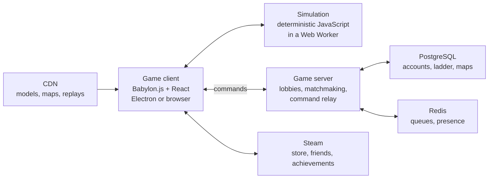

# Warshard — Real-Time Strategy Game Plan

Oct 27, 2026 · Laud Zion Cascalla

> **Warshard** is the game's title. "W3 Reforge" is only the file and internal project name; the game never refers to Warcraft or Blizzard. This project is separate from Heartshard: different world, different story, different tech.

## Vision and pitch

Build an original real-time strategy game in the spirit of Warcraft III: heroes who level up, armies of distinct units, neutral monster camps, a rich campaign and a map editor that lets players build their own games. Where Warcraft III had four races, this game has **eight**, each with its own models, buildings, heroes, economy twist and story.

- **Title:** *Warshard*. The name comes from the story: the broken crown's eight gem shards are what the races go to war over. A web search found only a small hobby wargame project on GitHub with that name; run a formal trademark search before announcing.
- **Genre:** real-time strategy with RPG heroes, 3D, top-down camera
- **Platforms:** PC on Steam and the browser first; consoles and tablets later if the controls work
- **Audience:** players who grew up on Warcraft III, its custom maps (tower defense, hero arenas, Legion TD-style games) and its campaigns
- **Hook:** eight truly different races, heroes you care about, and a map editor that makes the community part of the game

**IP rule:** take nothing from Blizzard: no names (Warcraft, Azeroth, Horde, Alliance, Scourge, Sentinels and so on), no unit or hero names, no models, icons, sounds, UI art or story. Mechanics are free to use: heroes with levels and items, neutral creeps, upkeep, day and night, two resources, tech tiers. Never use "Warcraft" or "Reforged" in the product name or store listing.

## How it differs from Heartshard

|             | Heartshard                                         | Warshard                                         |
| ----------- | -------------------------------------------------- | ------------------------------------------------ |
| Genre       | 2D pixel MMORPG                                    | 3D real-time strategy                            |
| Platform    | Android first                                      | PC (Steam) and browser first                     |
| Multiplayer | Persistent shared world, server decides everything | Short matches (1v1 to 4v4), lockstep simulation  |
| Money       | Free to play with cosmetics and a season pass      | Buy once, then cosmetics and campaign expansions |
| World       | Velmora, the Shards                                | The Eightfold Realm, the broken Pact (below)     |
| Art         | Pixel sprites                                      | Stylized low-poly 3D models                      |

## Core gameplay

- **Resources:** gold (mined) and timber (harvested from trees), plus **supply** from houses or their race's equivalent
- **Upkeep:** above 50 and 80 supply, gold income drops, so players choose between a big army and a strong economy
- **Heroes:** up to 3 per player, level 1 to 10, four abilities each with an ultimate at level 6, six item slots
- **Neutral camps:** monsters guard gold mines and treasure, giving heroes experience and items
- **Shops and taverns:** neutral shops sell items; the tavern lets any race hire neutral heroes
- **Day and night:** vision shrinks at night, and some races grow stronger in the dark or the light
- **Tech tiers:** three tiers per race, upgraded at the main hall
- **Attack and armor types:** a damage matrix (pierce, normal, siege, magic, hero against light, medium, heavy, fortified, hero) so every unit has a counter
- **Unit cap:** up to about 100 units per player, so battles stay readable

## The world: the Eightfold Realm

Long ago, eight peoples sealed **the Pact**: a crown of eight gems that kept peace between them, each gem held by one race. A thousand years later the crown has been broken. Each race holds a shard of its gem, a **warshard**, and believes another race broke the Pact. The campaign uncovers who really did it, race by race.

## The eight races

| # | Race                   | Theme                                            | Playstyle                                    | Economy twist                                           | Signature mechanic                                                         |
| - | ---------------------- | ------------------------------------------------ | -------------------------------------------- | ------------------------------------------------------- | -------------------------------------------------------------------------- |
| 1 | **The Freeholds**      | Human kingdoms of knights, farmers and engineers | Balanced, strong defense, flexible armies    | Peasants can pick up weapons as militia                 | Walls and gates that can be built anywhere                                 |
| 2 | **The Deepforged**     | Stout mountain folk of stone and steam           | Slow, heavy armor, powerful siege            | Mines yield more gold, but they harvest timber slowly   | Tunnels that link buildings for instant travel                             |
| 3 | **The Verdant Choir**  | Living plants and singing tree spirits           | Ambush, healing, map control                 | Buildings grow from seeds and can be replanted          | Roots spread across the ground and slow enemies on them                    |
| 4 | **The Ashborn Clans**  | Horned nomad warriors from the burning steppes   | Fast, aggressive, strong early game          | Workers carry more but there are fewer of them          | Walking war camps: buildings that pick up and move                         |
| 5 | **The Pale Legion**    | Bound spirits and the risen dead                 | Attrition: grows stronger as units die       | Spirits harvest without returning to base               | Fallen units on either side can be raised again                            |
| 6 | **The Brood**          | Insect swarm ruled by a queen                    | Cheap units in huge numbers, overwhelm       | Larvae eat corpses and plants to grow into new units    | Burrowing: units hide underground and ambush                               |
| 7 | **The Saltborn**       | Amphibious sea folk of the drowned coasts        | Mobile, controls water and shorelines        | Fish nets on water give extra gold                      | Tides: they can flood low ground to slow enemies and speed their own units |
| 8 | **The Astral Concord** | Star-touched mages and floating constructs       | Fragile but powerful magic and teleportation | Buildings draw power from star stones placed on the map | Warping: buildings and armies teleport between star stones                 |

### Heroes at launch (3 per race)

| Race               | Hero 1                         | Hero 2                               | Hero 3                            |
| ------------------ | ------------------------------ | ------------------------------------ | --------------------------------- |
| The Freeholds      | Lord Commander (tank, auras)   | Field Engineer (turrets, repairs)    | Lightbearer (healer)              |
| The Deepforged     | Thane of Stone (tank, stuns)   | Runesmith (buffs gear and buildings) | Blastmaster (siege, area damage)  |
| The Verdant Choir  | Elder Bark (tank, entangle)    | Songweaver (heals, sleep)            | Thorn Stalker (ranged assassin)   |
| The Ashborn Clans  | Warchief (charges, war cries)  | Ember Shaman (fire, totems)          | Beast Rider (fast raider)         |
| The Pale Legion    | Grave Lord (raises the dead)   | Wailing Lady (fear, silence)         | Bone Knight (melee lifesteal)     |
| The Brood          | Hive Queen (spawns larvae)     | Venom Lurker (poison, burrow)        | Carapace Titan (tank)             |
| The Saltborn       | Tide Priestess (floods, heals) | Harpoon Captain (pulls, ranged)      | Deep Leviathan Caller (summons)   |
| The Astral Concord | Starseer (vision, prophecy)    | Void Architect (teleports buildings) | Comet Knight (dives from the sky) |

Each race has about **10 units**, **10 buildings** and **3 heroes** at launch, plus a neutral pool of tavern heroes and monster camps.

### Launch scope

Eight asymmetric races is the biggest risk in the plan. Balancing them takes years in big studios.

- **Early access:** 4 races (Freeholds, Ashborn Clans, Pale Legion, Verdant Choir), the classic balance of defense, aggression, attrition and control
- **Version 1.0:** add the Deepforged and the Brood
- **First expansion:** add the Saltborn and the Astral Concord, with their campaign chapters

## Game modes

- **Campaign:** one act per race (8 acts), each 6 to 8 missions, released in step with the races
- **Melee:** 1v1, 2v2, 3v3, 4v4 and free-for-all, ranked and casual
- **Co-op against AI:** with difficulty levels
- **Custom games:** anything players build in the editor, browsable in a lobby list
- **Replays and observer mode:** built in from day one, because the lockstep design makes replays tiny

## Map editor and custom games

Warcraft III lived for 20 years because of its custom maps. The editor is a core feature, not an extra.

- Terrain, doodads, units, regions and triggers in a visual editor
- **Triggers in plain language** ("when a unit enters region, give player 50 gold") for beginners, and sandboxed JavaScript for advanced creators
- **Templates** to start fast: tower defense, hero arena, survival, Legion TD-style builder games, castle fight
- Custom races and units built from the game's own models and data
- One-click publishing to the in-game map browser, with ratings and featured maps
- Map scripts run in a sandbox with no network or file access, so a map can never harm a player's computer

## Tech stack

Plain JavaScript end to end, following the project rules.

| Layer                | Choice                                                                   | Why                                                                                                          |
| -------------------- | ------------------------------------------------------------------------ | ------------------------------------------------------------------------------------------------------------ |
| 3D rendering         | Babylon.js                                                               | Full 3D engine in JavaScript with a strong RTS-ready feature set: instancing, shadows, picking, an inspector |
| Simulation           | Custom deterministic engine in plain JavaScript, running in a Web Worker | The game logic must give the exact same result on every player's machine                                     |
| Math                 | Fixed-point integers instead of floating point                           | Floating point can differ between machines and break lockstep                                                |
| Pathfinding          | Grid A* for single units, flow fields for groups                         | Hundreds of units moving smoothly                                                                            |
| Desktop app          | Electron with steamworks.js                                              | Steam store, achievements, friends and lobbies                                                               |
| Menus and editor UI  | React + Vite                                                             | Follows the React rules; shared components                                                                   |
| Game server          | Node.js: lobbies, matchmaking, relay, ranked ladder                      | Lightweight, because the clients run the simulation                                                          |
| Networking           | WebSocket relay (WebRTC later)                                           | Simple and reliable through firewalls                                                                        |
| Database             | PostgreSQL                                                               | Accounts, ladder ratings, match history, published maps                                                      |
| Cache and queue      | Redis + BullMQ                                                           | Matchmaking queues, presence, replay processing                                                              |
| Validation           | zod                                                                      | Lobby messages, API requests, map files                                                                      |
| Models and animation | Blender, exported as glTF                                                | Open format that Babylon.js loads directly                                                                   |
| Tests                | Vitest                                                                   | Determinism tests replay the same match twice and compare results                                            |

### How multiplayer works: lockstep

RTS games don't send unit positions over the network; there are too many units. Every player runs the same simulation, and only the **commands** ("move these 12 units here") travel between players.

1. Each player's commands are sent to the relay server.
2. The relay bundles all players' commands for a game turn (about every 100 ms) and sends the bundle to everyone.
3. Every machine applies the same commands in the same order and gets the same result.
4. Every few seconds each machine sends a checksum of the game state. If one differs, the game reports a **desync** with a log for debugging.

This gives tiny bandwidth, small replays (just the command list) and protection from cheats that change unit stats. The weak spot is map hacks (seeing hidden units), which is handled by checks on the client and by reporting.

### System architecture



## Folder structure

One repository, one modular monolith, plain JavaScript, kebab-case files. The simulation is a pure package with no rendering or network code, so it can run in the client, in tests and on the server for replay checks.

```
/
├── sim/                                    # Deterministic game engine: pure JavaScript, no DOM, no network
│   ├── src/
│   │   ├── world.js                        # Game state and the fixed-step tick
│   │   ├── commands/                       # Command pattern: move, attack, build, cast, train
│   │   ├── systems/                        # combat, movement, pathfinding, economy, upkeep, day-night, fog
│   │   ├── math/fixed.js                   # Fixed-point math used everywhere instead of floats
│   │   ├── random.js                       # Seeded random so every machine rolls the same
│   │   └── checksum.js                     # State hash for desync detection
│   └── tests/                              # Determinism and balance tests
│
├── client/                                 # Electron and browser game
│   └── src/
│       ├── main.js
│       ├── scenes/                         # menu, lobby, loading, match, score screen, replay
│       ├── render/                         # Babylon.js: units, terrain, effects, camera, minimap
│       ├── input/                          # Selection, hotkeys, control groups, camera
│       ├── features/<feature>/             # lobby, matchmaking, ladder, replays, profile, shop
│       ├── components/ui/                  # Shared React widgets: button, panel, tooltip, command card
│       ├── configs/                        # public.js, graphics.js, hotkeys.js, api.js, audio.js
│       └── lib/                            # net/, api/, steam/ (adapter), fx/, analytics.js, toast.js
│
├── editor/                                 # Map editor (React + Babylon.js)
│   └── src/
│       ├── panels/                         # terrain, units, regions, triggers, publish
│       ├── triggers/                       # Plain-language trigger blocks
│       └── sandbox/                        # Runs map scripts with no network or file access
│
├── server/                                 # Node: lobbies, matchmaking, relay, ranked, map hosting
│   ├── src/
│   │   ├── modules/<module>/               # accounts, lobbies, matchmaking, relay, ladder, replays, maps, shop, admin
│   │   │                                   # each with routes.js, controller.js, service.js, repository.js, jobs.js
│   │   ├── middleware/, configs/, lib/     # Same rules as every project (env.js, events, queue, cache)
│   │   └── db/                             # client.js, migrations/, seeds/
│   └── tests/
│
├── shared/                                 # Plain JavaScript used by sim, client, editor and server
│   ├── data/
│   │   ├── races/                          # freeholds.js, deepforged.js, verdant-choir.js, ashborn.js,
│   │   │                                   # pale-legion.js, brood.js, saltborn.js, astral-concord.js
│   │   ├── heroes/, items/, neutrals/      # Hero abilities, shop items, creep camps
│   │   └── damage-matrix.js                # Attack type against armor type
│   ├── schemas/                            # zod schemas for commands, lobby messages, map files
│   └── constants/                          # Command types, protocol version
│
├── assets/                                 # Blender sources and exported glTF models, textures, audio
├── maps/                                   # Official melee and campaign maps
├── scripts/                                # migrate.mjs, seed.mjs, reset.mjs, build-assets.mjs, balance-report.mjs
├── docs/
└── package.json                            # npm workspaces: sim, client, editor, server, shared
```

## Engineering rules applied

| Rule or pattern          | Where it is used                                                                                                                                                                   |
| ------------------------ | ---------------------------------------------------------------------------------------------------------------------------------------------------------------------------------- |
| **Command pattern**      | Every player action is a command object. Commands are what the network sends, what replays store and what the AI issues.                                                           |
| **Repository**           | Accounts, ladder, maps and replays are read and written only through each module's `repository.js`.                                                                                |
| **Strategy**             | AI difficulty levels and AI personalities (rusher, turtle, expander) share one interface.                                                                                          |
| **Factory**              | Units, buildings and heroes are built from `shared/data/` by one factory.                                                                                                          |
| **Observer**             | Simulation events (`unit.died`, `hero.leveled`, `building.finished`) feed sounds, effects, the score screen, achievements and analytics without the simulation knowing about them. |
| **Adapter**              | Steam, analytics and storage are wrapped, so the browser build runs without Steam.                                                                                                 |
| **Builder**              | Map creation in the editor and match setup (players, teams, races, map, rules).                                                                                                    |
| **ACID and idempotency** | Ladder results, purchases and map publishing run in transactions; every match result has a unique ID and is recorded only once.                                                    |
| **Queueing**             | Replay processing, ladder updates, map validation and screenshots run as background jobs.                                                                                          |
| **Caching**              | Map browser listings and ladder pages are cached and refreshed after each change.                                                                                                  |
| **API versioning**       | HTTP routes under `/api/v1`; a protocol version in every match, so players on different builds never join the same game.                                                           |
| **Configs**              | Every unit stat, cost, build time and damage value lives in `shared/data/`, never in code. Balance patches are data changes.                                                       |

## Art direction

- **Stylized low-poly 3D** with hand-painted textures: chunky shapes, bold colors and clear silhouettes, so every unit is readable from the top-down camera.
- Each race has its own **shape language and palette**: Freeholds in blue and steel, Ashborn in red and bone, Verdant Choir in green and gold, and so on. Team colors stay on banners and trims.
- **Visible upgrades:** weapon and armor upgrades change unit models, so you can see an upgraded army.
- **Scale of the art work:** about 100 units, 24 heroes and 80 buildings across eight races, each with idle, walk, attack, death and spell animations. This is the biggest cost in the plan.
- Original models only. Asset store models are fine for prototypes and neutral monsters, then replaced.

## Monetization

Buy once, never pay to win.

| Product         | What it is                                                                      | Approx. price                      |
| --------------- | ------------------------------------------------------------------------------- | ---------------------------------- |
| Base game       | 4 races at early access, all modes, editor, online play                         | $14.99 early access, $24.99 at 1.0 |
| Race expansions | New races with their campaign acts (all players can play against them for free) | $9.99 each pack                    |
| Cosmetics       | Hero skins, unit skins, portraits, building themes                              | $1.99–9.99                         |
| Supporter pack  | Soundtrack, art book, a profile badge                                           | $9.99                              |

Custom maps are always free to make, publish and play.

## Balancing eight races

- Every number lives in `shared/data/`, so balance changes are data patches with no code changes.
- The server records win rates by race pair, map and rating band. An admin dashboard shows them after every patch.
- A public test realm for patches before they reach ranked.
- Automated AI-versus-AI matches run every night to catch broken units before players do.

## Roadmap

| Phase          | When            | What                                                                                                           |
| -------------- | --------------- | -------------------------------------------------------------------------------------------------------------- |
| Plan           | Month 1         | Design doc, race sheets, art style tests, repo set up with the folder structure above                          |
| Prototype      | Months 2 to 4   | Deterministic simulation, one race against itself, workers, two units, one hero, lockstep between two browsers |
| **Gate**       |                 | **Two players finish a match with no desync and it feels fun**                                                 |
| Vertical slice | Months 5 to 9   | Freeholds and Ashborn complete, one melee map, the first 3 campaign missions, replays                          |
| **Gate**       |                 | **Ten testers play 1v1s for a week and want more**                                                             |
| Early access   | Months 10 to 18 | 4 races, 6 melee maps, ranked 1v1, co-op against AI, the map editor, 2 campaign acts, Steam early access       |
| **Gate**       |                 | **Win rates for every race pair between 45% and 55%**                                                          |
| Version 1.0    | Months 19 to 28 | Deepforged and Brood, team modes, 4 campaign acts, map browser with ratings                                    |
| Expansion      | After 1.0       | Saltborn and Astral Concord, the final campaign acts, tournaments                                              |

## Team and budget

This is a bigger project than Heartshard. 3D models, animation and balance for eight races need more people.

| Role                               | Need                                                     |
| ---------------------------------- | -------------------------------------------------------- |
| You                                | Simulation, networking, server, client code              |
| 3D artist (freelance or part-time) | Units, heroes and buildings for each race                |
| Animator (freelance)               | Unit and hero animations                                 |
| Sound designer (freelance)         | Unit voices, effects, music (or licensed packs early on) |
| Balance and community (later)      | Testing, patch notes, tournaments                        |

| Item                              | Approx. cost to early access                              |
| --------------------------------- | --------------------------------------------------------- |
| 3D models and animation (4 races) | $15,000–40,000, or $500–2,000 in asset packs to prototype |
| Sound and music                   | $1,000–5,000                                              |
| Servers through early access      | $1,000–3,000                                              |
| Steam fee                         | $100 per game                                             |
| Tools and misc.                   | About $300                                                |
| **Total**                         | **Roughly $17,000–48,000**                                |

### This week

- [ ] Run a formal trademark search on *Warshard* and reserve the domain, Steam page name and social handles
- [ ] Write a one-page sheet for each of the first 4 races: units, buildings, heroes, economy twist
- [ ] Set up the repo with the folder structure above and npm workspaces
- [ ] Tech test: a fixed-point simulation of 200 units moving with flow fields, run twice with the same seed to prove the results match
- [ ] Tech test: two browser tabs in lockstep through a small Node relay
- [ ] Buy a low-poly fantasy asset pack to prototype with

**Biggest risk: scope and balance.** Ship 4 races that feel great before adding the next 4. A smaller game that is fun beats eight races nobody can balance.
